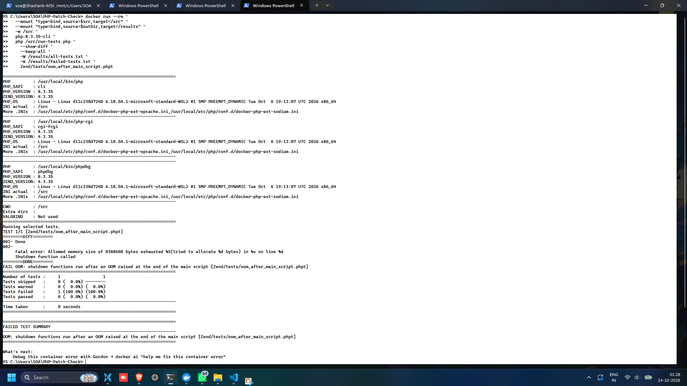
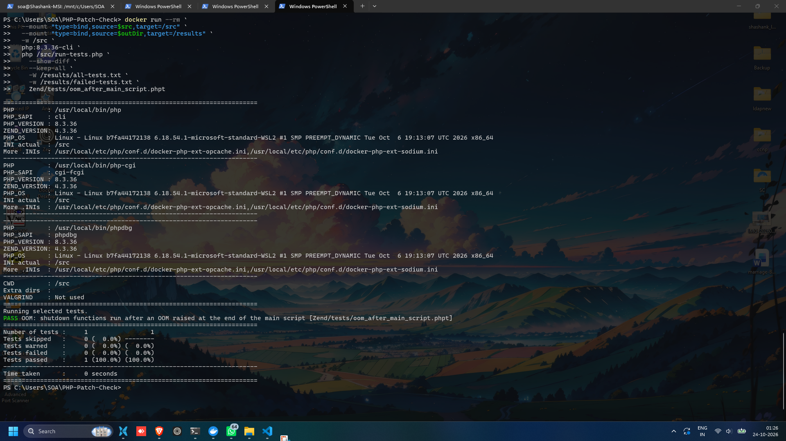

# PHP Patch Check

A defensive regression-testing lab comparing PHP **8.3.35** (before the fix) with **8.3.36** (patched) using PHP's upstream out-of-memory regression test.

> **Scope note:** This project demonstrates a version-to-version difference in one upstream regression test. It is not an exploit, does not attempt remote code execution, and does not prove that either CVE is exploitable or fully validated by this test alone.

## The bug, in plain English

Imagine PHP is halfway through setting up a request when it runs out of memory. PHP can jump out of the current operation before all the request's internal state has been initialized. If cleanup then treats that half-finished state as though setup completed normally, it may use invalid or inconsistent data. Under particular server configurations, this can become a serious security problem.

Put simply: **when a request runs out of memory, PHP may jump out halfway through a job and later trust the half-finished job as if it were done.**

The October 2026 PHP security releases address two critical issues:

- **CVE-2026-109618 — OOM corruption:** request memory can be left in an invalid state when an out-of-memory error interrupts initialization; later shutdown handling may consume that state.
- **CVE-2026-109619 — stale request state:** some internal state associated with a request may persist into a later request after its backing memory has been freed.

These are related low-level PHP engine issues, but the regression test documented below specifically checks OOM/shutdown behavior. It does **not** independently test CVE-2026-109619.

## What this checker does

The current lab runs the same PHP upstream test, `Zend/tests/oom_after_main_script.phpt`, in two disposable Docker containers:

1. Runs the test using `php:8.3.35-cli`.
2. Runs the same test using `php:8.3.36-cli`.
3. Compares the test outcome and, on failure, displays the output difference.
4. Keeps the console output and result files so the comparison can be reviewed.

The observed result in this environment was:

| PHP image | Result |
|---|---|
| `php:8.3.35-cli` | **FAIL** — expected output did not match; the `Done` line was missing. |
| `php:8.3.36-cli` | **PASS** — output matched the regression test's expected output. |

This is a **regression-test comparison**, not a general-purpose vulnerability scanner. It uses PHP CLI, and the CVE's documented exploitation conditions include specific web-server configurations. A passing test is useful evidence of changed behavior, but it is not proof of remote-code-execution impact or a complete CVE validation.

## Requirements

- Windows with PowerShell (the commands below use PowerShell syntax)
- Docker Desktop running with Linux containers enabled
- PHP source tree for tag `php-8.3.36`, downloaded from the official PHP source repository
- The upstream test file at `Zend/tests/oom_after_main_script.phpt`

## How to run it

### 1. Download the PHP source tree

From the project directory in PowerShell:

```powershell
Invoke-WebRequest `
  -Uri "https://github.com/php/php-src/archive/refs/tags/php-8.3.36.zip" `
  -OutFile ".\php-src-8.3.36.zip"

Expand-Archive `
  -Path ".\php-src-8.3.36.zip" `
  -DestinationPath "." `
  -Force

$src = Join-Path $PWD "php-src-php-8.3.36"
Test-Path (Join-Path $src "Zend/tests/oom_after_main_script.phpt")
```

The final command should return `True`. If the extracted folder has a different name, set `$src` to that folder instead.

### 2. Run the same test against both PHP versions

The repository includes a reusable PowerShell script at [`scripts/run-comparison.ps1`](scripts/run-comparison.ps1). From the project root, run:

```powershell
.\scripts\run-comparison.ps1
```

By default, the script expects the extracted source folder `php-src-php-8.3.36` in the project root. If your source is somewhere else, pass its path:

```powershell
.\scripts\run-comparison.ps1 -SourcePath "C:\path\to\php-src-php-8.3.36"
```

The script checks that Docker is running and that the upstream test and test runner exist, then runs the same test in disposable `php:8.3.35-cli` and `php:8.3.36-cli` containers. It saves the full console output to `results-8.3.35/console-output.txt` and `results-8.3.36/console-output.txt`. Docker downloads the images if they are not already present. The test uses `--show-diff` to show output mismatches and `--keep-all` to retain test artifacts.

### 3. Review the evidence

Open these files:

- `results-8.3.35/console-output.txt`
- `results-8.3.36/console-output.txt`

Look for the test summary and `FAIL` / `PASS` status. The failure report alone does not contain the full output diff; the saved console log does.

## Before and after

### Before patch: PHP 8.3.35

The upstream test fails. In the observed output, the expected `Done` line is absent before the out-of-memory fatal error and shutdown-function message.



### After patch: PHP 8.3.36

The same test passes against the patched release.



## What I learned

- A version check alone is weaker evidence than running the same reproducible test against a vulnerable and a patched build.
- Out-of-memory handling is part of security: cleanup code must not assume request initialization completed successfully.
- PHP's `.phpt` test runner reports a behavioral regression by comparing actual output with expected output.
- Docker makes it practical to compare two PHP versions in isolated, repeatable environments.
- A regression test has a defined scope: passing one test does not prove that every vulnerability or deployment configuration is safe.

## Official sources

- [PHP 8.3.36 security release announcement (21 October 2026)](https://php.net/releases/8_3_36.php)
- [PHP GitHub Security Advisory — CVE-2026-109618: RCE via OOM corruption](https://github.com/php/php-src/security/advisories/GHSA-w8hw-w9fx-j79w)
- [PHP GitHub Security Advisory — CVE-2026-109619: stale request state](https://github.com/php/php-src/security/advisories/GHSA-6wmf-4rv5-p3rp)

## Disclaimer

This is a learning and defensive verification lab. Run security testing only on systems you own or are explicitly authorized to test. Keep production PHP installations updated to a supported, patched release; this lab is not a substitute for patching.
